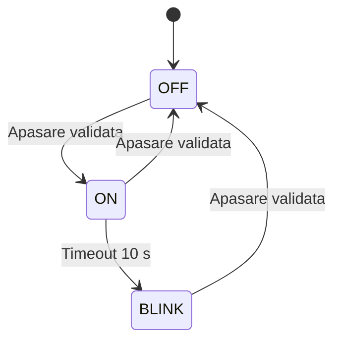

# Laborator 6.1 — Button LED cu FSM

Mediu activ implicit: `megaatmega2560_lab61` (LAB_SELECT=18), Mega 2560,
Serial 115200 baud. Upload din PlatformIO pentru acest mediu.
Fara FreeRTOS sau biblioteci externe suplimentare.

## Conexiuni

- D22 -> buton -> GND; INPUT_PULLUP, apasare activa LOW.
- D7 -> rezistor 220 ohmi -> anod LED; catod -> GND.
- Alimentare USB. Alegeti contacte ale butonului care se unesc la apasare.

## Comportament

Initial OFF. Apasare validata 30 ms: OFF -> ON, ON -> OFF, BLINK -> OFF.
Dupa 10 secunde in ON: ON -> BLINK. In BLINK LED-ul incepe aprins,
apoi alterneaza 500 ms ON / 500 ms OFF. Apasarea are prioritate fata de
un timeout detectat in aceeasi iteratie. Mentinerea butonului nu genereaza
apasari repetate; eliberarea trebuie validata inainte de o noua apasare.
Un buton tinut apasat la reset este recunoscut dupa debounce.

STDIO printf raporteaza la pornire si la tranzitii; fazele LED-ului in
BLINK nu sunt tranzitii intre stari FSM si nu umplu monitorul serial.
Nu exista comenzi Serial: interactiunea este prin buton.

## Module

- `lib/BUTTON_LIB`: driver existent, debounce si eveniment consumat o data.
- `lib/LED_LIB`: driver existent pentru iesire activa HIGH.
- `lib/SERIAL_STDIO_LIB`: adaptor existent Serial/STDIO.
- `lib/BUTTON_LED_FSM_LIB`: FSM reutilizabil, independent de Arduino;
  primeste timpul si evenimentul, ofera starea si iesirea LED.
- `src/lab_6/app_lab_6.1.h/.cpp`: lab61Setup / lab61Loop, conecteaza modulele.
- `src/main.cpp`: selectia aplicatiei.



## Validare

Test host pentru tranzitii, prioritate, timeout, clipire, millis rollover,
debounce, mentinere si iesiri ale aplicatiei:

```sh
c++ -std=c++11 -Wall -Wextra -Werror -Itest/sequential_host -Ilib/BUTTON_LED_FSM_LIB -Ilib/BUTTON_LIB -Ilib/LED_LIB -Ilib/SERIAL_STDIO_LIB -Isrc/lab_6 test/button_led_fsm/test.cpp lib/BUTTON_LED_FSM_LIB/buttonLedFsm.cpp lib/BUTTON_LIB/dd_button.cpp lib/LED_LIB/dd_led.cpp src/lab_6/app_lab_6.1.cpp -o /tmp/lab61-test
/tmp/lab61-test
pio run -e megaatmega2560_lab61
```

Pe hardware: verificati OFF la reset, o singura tranzitie pe apasare,
ON -> BLINK dupa 10 s, clipirea, revenirea in OFF si mesajele Serial.
Testele host si compilarea nu inlocuiesc demonstrarea fizica.
