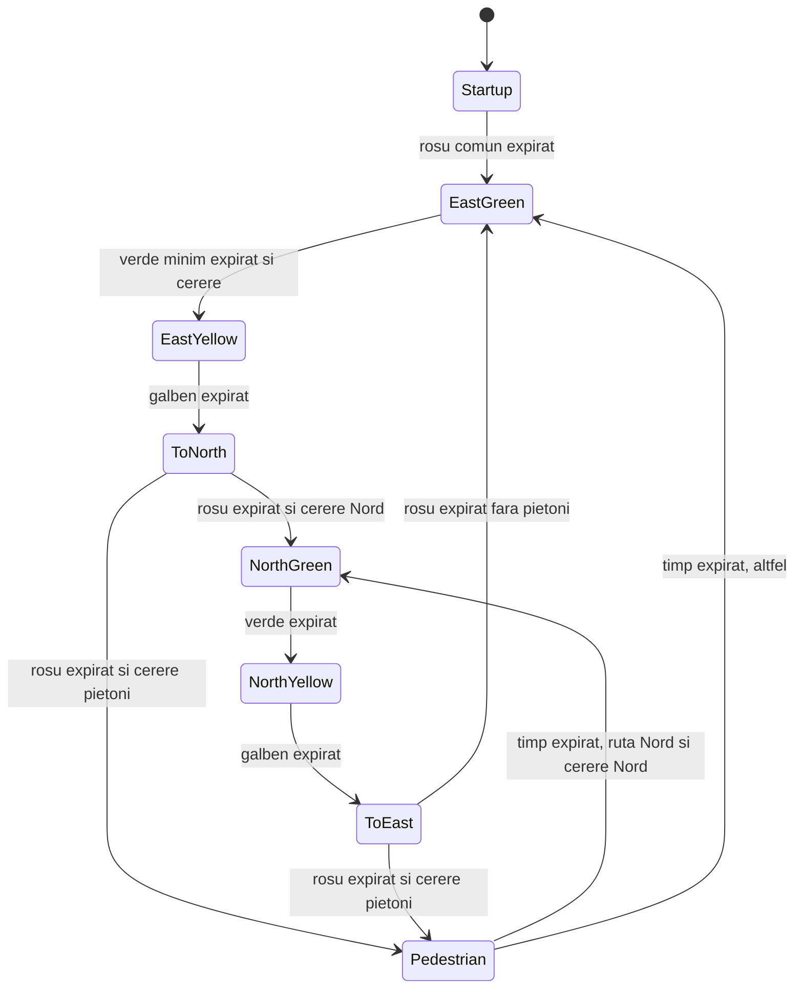

# Lab 6.2 — Semafor inteligent cu FSM si FreeRTOS

Mediul implicit este `megaatmega2560_lab62`, LAB_SELECT=19, Arduino Mega
2560. Serial Monitor: 115200 baud. Interactiunea este prin butoane, nu comenzi.

## Circuit

Fiecare iesire LED: pin -> rezistor propriu 220 ohmi -> anod; catod -> GND.
Est: rosu D4, galben D5, verde D6. Nord: rosu D7, galben D8, verde D9.
Cerere Nord: D22 -> buton -> GND. Pietoni: D24 -> buton -> GND.
Butoane INPUT_PULLUP, debounce 30 ms. Alimentare USB. D24 poate ramane
neconectat daca extensia pietonala nu este folosita.

## Comportament

La pornire ambele rosu 1 s, apoi Est verde. Fara cerere ramane Est verde.
Cererea Nord se memoreaza pana la servire; mai multe apasari se reunesc.
Est are minimum 5 s verde, apoi galben 2 s, ambele rosu 1 s, Nord verde
5 s, Nord galben 2 s, ambele rosu 1 s, apoi Est verde minimum 5 s.
Apasarile Nord in timpul verdelui Nord sunt considerate deservite.
Apasarile ulterioare se memoreaza pentru ciclul urmator.

Extensie: cererea pietonala asteapta galbenul si intervalul rosu comun,
apoi pastreaza ambele rosu 5 s. Nu se intrerupe verdele Nord de 5 s sau
verdele minim Est. Dupa faza pietonala aflata in drumul spre Nord se
serveste cererea Nord daca exista; dupa faza aflata in drumul spre Est
se acorda intai verdele minim Est. Apasarile in faza pietonala sunt
considerate deservite. Faza pietonala este indicata explicit in Serial.
Acesta este un montaj didactic, nu un controler rutier certificat.

## Structura

- BUTTON_LIB si LED_LIB: drivere existente, nemodificate.
- TRAFFIC_LIGHT_LIB: interfata pentru un grup R/G/V, opreste iesirile
  inainte sa activeze culoarea ceruta.
- TRAFFIC_FSM_LIB: FSM independent de Arduino/FreeRTOS; starea comuna
  stabileste simultan starea fiecarei directii. Timpi configurabili.
- RTOS_SERIAL_STDIO_LIB: adaptor existent pentru printf prin Serial.
- app_lab_6.2: task cereri (prioritate 2), task control (3), raportare (1).
  Un singur task scrie luminile, evitand decizii concurente incompatibile.
  La tranzitii se retrag permisiunile ambelor directii inaintea activarii.
- Doua semafoare binare transporta cererile; FSM le memoreaza dupa consum.
- Coada de lungime 1 transporta instantanee catre raportare. Pastreaza
  ultima stare; evenimente apropiate pot fi comasate, fara blocarea FSM.

FreeRTOS 11.1.0-3, deja folosit in proiect. Taskurile cereri/control au
vTaskDelayUntil pentru perioada nominala 10 ms, rotunjita in sus la un
numar intreg de tickuri. Pe AVR tickul nominal este aproximativ 16 ms.
Duratele fazelor sunt rotunjite in sus; tranzitia poate intarzia suplimentar
cu un ciclu de control. Clock-ul watchdog nu este un ceas de precizie.
Raportarea asteapta coada si foloseste printf numai din taskul propriu.
Nu se afiseaza din ISR. Counterul de timp extinde rollover-ul tickului AVR.

## Diagrama FSM



## Testare

```sh
c++ -std=c++11 -Wall -Wextra -Werror -Ilib/TRAFFIC_LIGHT_LIB -Ilib/TRAFFIC_FSM_LIB test/traffic_fsm/test.cpp lib/TRAFFIC_FSM_LIB/trafficFsm.cpp -o /tmp/traffic-fsm-test
/tmp/traffic-fsm-test
pio run -e megaatmega2560_lab62
```

Testele verifica succesiunea, verdele minim, cererile multiple, ignorarea
cererilor deja deservite, pietonii, rollover si absenta permisiunilor
simultane in ambele directii. Pe placa verificati culorile, mesajele,
mentinerea butonului, cereri in toate fazele si butoane simultane.
Compilarea si testele host nu confirma functionarea fizica.
