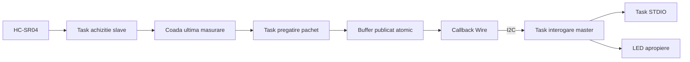

# Lab 7.1 — Doua Mega 2560, HC-SR04 si I2C

## Incarcare

Cele doua placi au programe DIFERITE. In PlatformIO > Project Tasks:
- `megaatmega2560_lab71_slave` > Upload pe placa cu senzorul.
- `megaatmega2560_lab71_master` > Upload pe placa care raporteaza.

Master este mediul implicit. Selectati explicit portul corect daca sunt
conectate ambele placi (sau incarcati pe rand cu circuitul nealimentat).
Nu folositi Upload implicit pentru ambele placi. Monitorul masterului:
115200 baud, fara comenzi de tastat. Slave-ul nu are raportare Serial;
LED-ul integrat aprins permanent indica esec la initializarea aplicatiei.

## Conexiuni (ambele placi 5 V)

- Master D20 SDA -> slave D20 SDA.
- Master D21 SCL -> slave D21 SCL.
- GND master -> GND slave -> GND senzor.
- HC-SR04 numai pe slave: VCC=5V, TRIG=D6, ECHO=D2, GND=GND.
- Optional master D7 -> rezistor 220 ohmi -> anod LED, catod -> GND.
- Pull-up SDA si SCL spre 5V: verificati cele deja montate pe placile Mega;
  daca este necesara o pereche externa, folositi cate 4.7 kohmi pe linie.
- La alimentare USB separata nu uniti direct pinii 5V ai placilor.
- Nu deconectati fire in timp ce circuitul este alimentat. Masterul poate
  raporta eroare cat timp slave-ul nu a fost pornit/programat.

## Protocol

I2C hardware Wire, adresa slave 7 biti 0x12, ceas master 100 kHz.
Master scrie comanda GET_DISTANCE=0x01, apoi cere exact 9 octeti.
Slave serveste cel mai recent pachet pregatit; nu masoara la cerere.

| Offset | Semnificatie |
| --- | --- |
| 0 | HEAD 0xAA |
| 1 | LENGTH=6 (numai payload) |
| 2 | ID senzor=1 |
| 3 | Status: 0 valid, 1 fara proba, 2 timeout ECHO, 3 in afara intervalului |
| 4,5 | Distanta mm, octet inferior primul |
| 6,7 | Numar proba uint16, octet inferior primul |
| 8 | Suma octetilor 0..7 modulo 256 |

Nu se transmit structuri brute. Lipsa ecoului nu reprezinta distanta zero:
masterul foloseste valoarea numai cand statusul este valid. Domeniu valid
20..4000 mm. Suma detecteaza erori, nu este CRC si nici autentificare.
Numarul probei avanseaza inclusiv la erori de senzor si revine la 0 dupa
65535. Formatul accepta numai senzorul 1 in aceasta implementare.

## Module si FreeRTOS

- HCSR04_LIB: driver propriu AVR, TRIG de minimum 10 us si ECHO prin
  intrerupere CHANGE pe D2. Timpi micros, copie atomica a duratei.
- DISTANCE_PROTOCOL_LIB: codificare, decodificare si verificare pachet.
- DISTANCE_I2C_LIB: Wire, callbacks slave, buffer publicat, cerere master.
- RTOS_SERIAL_STDIO_LIB si LED_LIB: reutilizate.
- FreeRTOS 11.1.0-3: biblioteca externa folosita deja in proiect.
- Wire: biblioteca inclusa in framework Arduino AVR.

Slave: task achizitie (prioritate 2, perioada ceruta 100 ms) -> coada de
lungime 1 -> task pregatire buffer (prioritate 1). Asteptarea ECHO cedeaza
CPU prin vTaskDelay(1), cu timeout aproximativ 40 ms; ISR captureaza durata.
Un puls mai lung de 30 ms este tratat drept timeout. Nu exista asteptare
activa lunga cu intreruperile dezactivate.

Taskul pregateste un pachet local si copiaza atomic doar 9 octeti in buffer.
Callback-ul Wire, rulat in ISR pe AVR, doar transmite bufferul. Nu foloseste
printf, delay sau mutex. Nu poate vedea jumatate de pachet nou si jumatate
vechi. Pana la prima masurare bufferul contine FARA_PROBA.

Master: task interogare (prioritate 2, perioada ceruta 500 ms) -> coada de
lungime 1 -> task printf (prioritate 1). Numai taskul interogare foloseste
Wire. Timeout Wire 25 ms cu reset periferic, daca API-ul frameworkului il
suporta. Verifica erori de magistrala, lungime, HEAD, checksum si payload.
Aceeasi proba timp de 1500 ms este raportata DATE VECHI; varsta se masoara
local la master, fara presupunerea ca ceasurile MCU sunt sincronizate.

vTaskDelayUntil mentine recurenta. Milisecundele sunt rotunjite in sus la
tickuri; pe AVR tickul watchdog este nominal aproximativ 16 ms, nu precis.
Timpul microsecundelor pentru ECHO este separat de recurența RTOS.

## Extensie: alerta de apropiere

Master aprinde D7 sub 100 mm si stinge peste 120 mm; la egalitate sau in
banda pastreaza starea. La eroare sau date vechi LED-ul se stinge, iar
Serial arata explicit eroarea: un LED stins nu confirma absenta obstacolului.

## Validare

```sh
c++ -std=c++11 -Wall -Wextra -Werror -Ilib/DISTANCE_PROTOCOL_LIB test/distance_protocol/test.cpp lib/DISTANCE_PROTOCOL_LIB/distanceProtocol.cpp -o /tmp/distance-protocol-test
/tmp/distance-protocol-test
pio run -e megaatmega2560_lab71_master -e megaatmega2560_lab71_slave
```

Teste host: format, endian, statusuri, secventa, pachete trunchiate,
coruperea fiecarui bit si valori payload invalide. Compilare separata
pentru fiecare firmware. Verificarea fizica ramane necesara:
1. Miscati un obiect: distanta si numarul probei trebuie sa se actualizeze.
2. Apropiati sub 10 cm, apoi indepartati peste 12 cm: verificati LED-ul.
3. Fara ecou valid: verificati mesajul senzorului.
4. Porniti numai masterul: trebuie sa raporteze eroare I2C, nu sa se blocheze.


